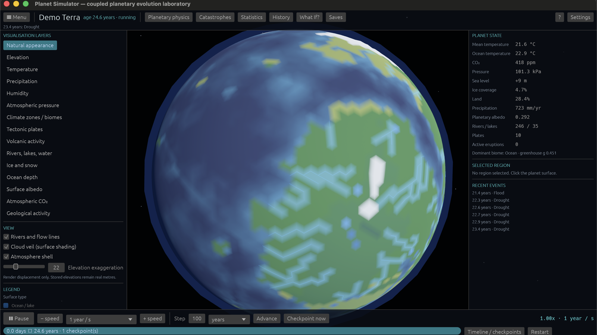
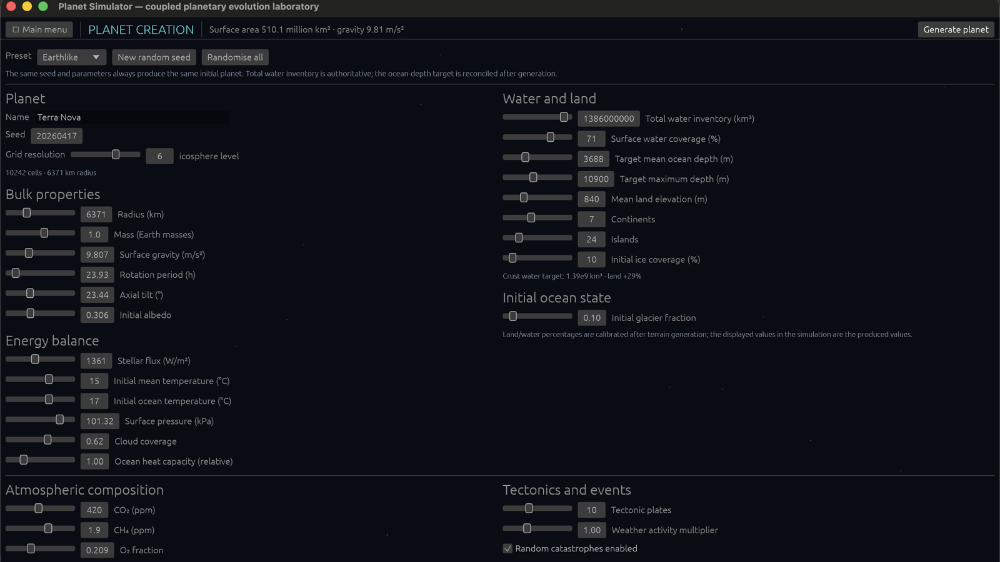
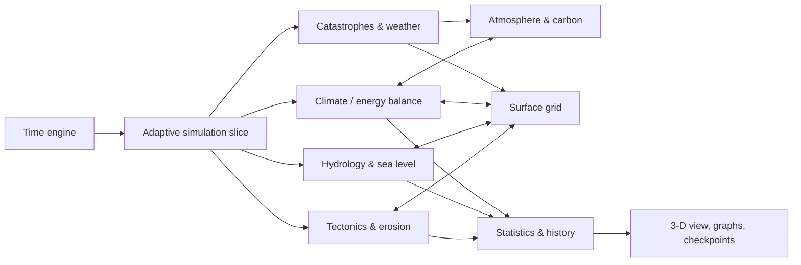

# Planet Simulator

**A coupled planetary evolution laboratory in Rust + Bevy.** Create a world from a seed, configure its atmosphere, water budget, orbit and geology, then watch climate, oceans, ice, rivers and tectonic plates evolve over years to billions of years.


[](https://github.com/geshtalbt/planet-sim/actions/workflows/ci.yml)



The planet is not a static sphere with decorative animations. Every visible change comes from the same state the physical modules read and write: surface temperatures, ocean heat, ice thickness, soil moisture, river discharge, atmospheric opacity and carbon reservoirs.

## Quick start

### Requirements

- Stable Rust **1.97+** (the project is built with 1.100).
- macOS, Linux or Windows with a working GPU (Metal, Vulkan or DirectX 12).
- First build compiles Bevy and takes several minutes.

On Debian/Ubuntu, install the usual Bevy system dependencies:

```bash
sudo apt update
sudo apt install build-essential pkg-config libasound2-dev libudev-dev \
  libx11-dev libxkbcommon-dev libwayland-dev
```

### Run

```bash
git clone https://github.com/geshtalbt/planet-sim.git
cd planet-sim
cargo run --release
```

For development, `cargo run` uses optimized dependencies and is faster to rebuild.

```bash
cargo run            # debug build, optimized dependencies
cargo test           # 17 simulation tests
cargo fmt            # formatting
cargo clippy --all-targets
```

Optional development shortcuts:

```bash
PLANET_DEMO=1 cargo run          # skip the menu: Earthlike planet, simulation running
PLANET_SCREEN=creation cargo run # open the planet creation screen
PLANET_UI=physics cargo run      # open a specific panel (physics, statistics,
                                 # catastrophes, history, saves, experiments)
```

The first run opens the **main menu**. Choose **New planet**, adjust the parameters (or press **Randomise all** / **Generate planet**), and the simulation starts. The default Earthlike preset uses an icosphere with 10,242 cells.

## First 60 seconds

1. **Create** a planet: name, seed, radius, mass/gravity, stellar flux, rotation, axial tilt, albedo, atmosphere, water inventory, ocean coverage, continents, islands, ice and plate count. The same seed + parameters always produce the same initial planet.
2. **Observe** it. Left-drag orbits, scroll zooms, clicking the surface selects a cell and exposes its elevation, water depth, temperature, precipitation, humidity, pressure, biome, plate, ice and river discharge.
3. **Switch layers** on the left: natural surface, elevation, temperature, precipitation, humidity, pressure, biomes, tectonic plates, volcanism, water, ice, ocean depth, albedo, CO₂ and geological activity. Each has a data-driven legend.
4. **Control time** at the bottom: pause, 15 speeds from one minute per second to one billion years per second, queued “Advance by” steps, checkpoints and timeline restore.
5. **Change the physics** from the top bar. CO₂, axial tilt, stellar flux, pressure, clouds, albedo, ocean heat capacity and water inventory all feed the running model. Controls show the current value, initial value and deviation.
6. **Break something.** Trigger a super-eruption, an asteroid impact, glaciation forcing, aerosol cooling or an ocean-circulation slowdown. Random catastrophes can be enabled and tuned. Events modify the underlying terrain, atmosphere and climate — not just the display.
7. **Experiment.** “What If?” forks the complete planet state. Change one parameter, let both branches run on the same clock, and compare temperature, CO₂, sea level, ice and land fraction.

| Planet creation | Simulation |
|---|---|
|  |  |

## How it works

### One state, many timescales

The simulation clock advances in adaptive slices. The UI batches real time to roughly 10–14 updates per second; at geological speeds a slice can represent millions of years. Slow processes use relaxed, stable schemes instead of trying to integrate every day individually.



- **Catastrophes and impacts** are evaluated before the energy balance so aerosols/dust affect the same slice. Regional weather is applied just after hydrology; its temperature anomalies influence the next slice.
- **Climate** updates per-cell temperatures from insolation, greenhouse forcing, albedo, aerosols, elevation and ocean heat capacity.
- **Hydrology** evaporates, precipitates, fills soil, routes runoff downhill, grows/melts snow and ice, and solves sea level from the water budget.
- **Tectonics** runs on a geological cadence: Euler-pole plate motion, boundary uplift/trenches, volcanism and erosion.
- Each step updates the same `SurfaceCell` data that renders the 3-D mesh and feeds the charts.

### Surface model

The planet is an **icosphere**. Each vertex is a cell; each cell stores bedrock elevation, ocean depth, lake depth, ice thickness, snow, air temperature, mixed-layer water temperature, soil water, precipitation, humidity, pressure, cloud cover, albedo, river discharge, flow target, biome, plate and local forcing. Global means are area-weighted.

Terrain generation combines seeded 3-D gradient noise, continent masks, ridged mountain noise, island bumps and plate-boundary relief. Sea level is calibrated to the requested water coverage, then the water inventory sets the mean ocean depth. Boundary uplift is added in metres after calibration so it cannot flatten the fractal terrain.

### Energy balance

A one-layer, latitude-resolved model:

- Annual mean insolation: `S/4 · (1 − 0.482 P₂(sin φ))`; daily insolation uses the solar declination from axial tilt and day of year.
- Planetary albedo: surface albedo and cloud fraction (`α_p = α_s(1−c) + 0.44c`).
- CO₂ forcing is logarithmic (`5.35 ln(C/280) W/m²`), with a fast water-vapour/lapse-rate feedback.
- Local targets include latitude, season, elevation lapse (6.5 K/km) and user/impact/weather forcing.
- Land relaxes quickly (τ ≈ 0.12 yr); the ocean mixed layer relaxes slowly (τ ≈ 2.4 × heat capacity years), producing land–sea contrast and seasonal lag.
- Ice/snow raise albedo, creating the ice–albedo feedback. Aerosols and impact dust reduce surface sunlight with a Beer–Lambert approximation.

### Water, ice and sea level

Total water (ocean + ice + soil) is conserved. Evaporation drives a normalised precipitation field; soil is a 0.4 m bucket; saturation excess and direct runoff are routed downhill; rivers are drawn where discharge exceeds a threshold. Snow accumulates below freezing, melts above zero, and excess ice becomes runoff. Sea level is solved iteratively so the ocean volume fits the remaining water after ice and soil storage; thermal expansion is reported as a separate eustatic offset.

Lakes are diagnostic sinks of the routed water balance; their storage does not drive global sea level. This limitation is deliberate and documented.

### Tectonics and catastrophes

Plates are spherical caps with Euler poles and angular speeds. Cells are reassigned to the nearest plate centre; relative motion across boundaries produces continental uplift, island arcs, trenches, ridges or rifts. Erosion relaxes land toward sea level with a precipitation-dependent time scale.

Volcanoes inject CO₂ from the geological reservoir, aerosols and lava relief. Asteroid impacts compute kinetic energy, crater diameter/depth, local deformation, thermal pulses and dust opacity. Glaciation forcing dims the star; whether a snowball develops is decided by the albedo/ice feedbacks, not a scripted animation.

### What-If, history and saves

- Full planet forks run on the same clock; comparison uses recorded history.
- History samples adapt to the elapsed time scale, so billion-year runs stay bounded.
- Full-state checkpoints support timeline restore at checkpoint resolution.
- Saves are versioned **gzip(JSON)** files containing terrain, climate, hydrology, tectonics, RNG state, active forks and history.
- Save location: `~/Library/Application Support/com.planetlab.PlanetSimulator/saves` on macOS, and the platform data directory elsewhere.

## Architecture

```
src/
  app.rs             Bevy resources, schedule and demo startup
  planet_generator/  seed, presets, noise, terrain/water generation
  terrain/           icosphere topology, cells, biomes, grid operations
  planetary_physics/ constants, insolation, radiative forcing, relaxation
  atmosphere/        composition, aerosols/dust, carbon reservoirs
  climate/           per-cell energy balance, temperature, albedo, biomes
  hydrology/         evaporation, precipitation, soil, rivers, sea level
  tectonics/         plates, Euler-pole motion, boundaries, uplift, erosion
  weather/           12 regional event types with real state effects
  catastrophes/      volcanoes, impacts, global forcings, random events
  statistics/        derived planet statistics
  history/           adaptive samples and event log
  time_engine/        clock, speed presets, queued steps
  simulation/        PlanetState integration, orchestration, forks
  save_system/       versioned compressed saves
  rendering/         planet/river mesh, layers, camera, atmosphere
  ui/                main menu, creation, simulation and science panels
```

The simulation core — everything except `app`, `rendering` and `ui` — does not depend on Bevy and is unit-tested independently. `examples/inspect.rs` is a headless diagnostic:

```bash
cargo run --profile test --example inspect -- 6
```

## Controls

| Input | Action |
|---|---|
| Left-drag | Orbit camera |
| Scroll | Zoom |
| Left-click | Select surface cell |
| Space | Pause / resume |
| Left / right arrow | Slower / faster time |
| Left panel | Data layer, clouds, rivers, atmosphere, exaggeration, legend |
| Bottom bar | Pause, speed, stepped advance, checkpoint, timeline |
| Right panel | Global state, selected region, local interventions |
| Top bar | Physics, catastrophes, statistics, history, What If?, saves |

## What is implemented — and what is not

Implemented and connected: procedural generation, 3-D surface and all 15 layers, time engine, energy balance, regional climate, seasons, biomes, CO₂/CH₄ forcing, carbon exchange, evaporation/precipitation/soil/runoff/rivers, snow/ice/sea level, plate motion and boundary geology, volcanic/impact/global catastrophes, weather events, statistics, history, checkpoints, what-if forks, versioned saves, egui panels.

Deliberately simplified or not yet implemented: full 3-D atmospheric/ocean circulation, cloud microphysics, ice-sheet flow/calving, groundwater flow, sediment/delta modelling, particle-level rain/snow/lightning, a side-by-side twin 3-D viewport for what-if, GPU/WGSL compute kernels, magnetic dynamo physics. The exact matrix is in [`docs/STATUS.md`](docs/STATUS.md).

**Scientific honesty:** this is a simplified, scientifically inspired model, not a validated climate or geophysical simulator. It reproduces the direction and order of magnitude of the main feedbacks, not quantitative predictions. Assumptions, equations and limitations are documented in [`docs/MODEL.md`](docs/MODEL.md). All displayed values are computed from the simulation state; there are no decorative fake statistics.

## Tests

```bash
cargo test --lib
```

Covers seeded reproducibility, water-budget conservation, CO₂ redistribution, sea-level response to water inventory, catastrophes, decades of climate stability, fork/checkpoint/restart behaviour, save/load round-trip, icosphere topology, insolation and time controls.

## License

MIT. See [`LICENSE`](LICENSE).
