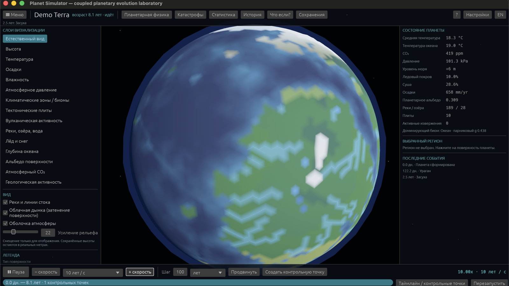
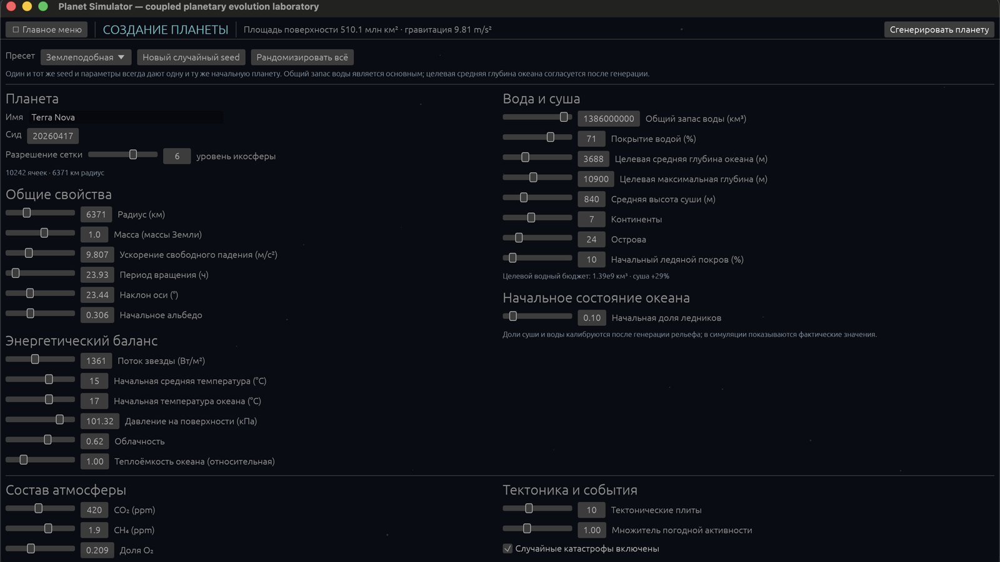
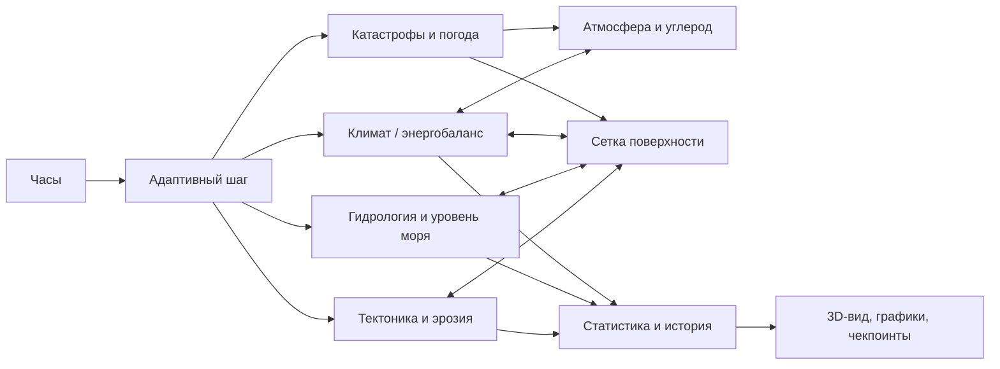

# Planet Simulator

[English](README.md) · **Русский**

**Связанная лаборатория эволюции планет на Rust + Bevy.** Создайте мир по seed, настройте атмосферу, запас воды, орбиту и геологию — и наблюдайте, как климат, океаны, лёд, реки и тектонические плиты эволюционируют от лет до миллиардов лет.


[](https://github.com/geshtalbt/planet-sim/actions/workflows/ci.yml)



Планета здесь — не статичная сфера с декоративными анимациями. Каждое видимое изменение вычисляется из того же состояния, которое читают и изменяют физические модули: температуры поверхности, тепло океана, толщина льда, влажность почвы, сток рек, оптическая толщина атмосферы и углеродные резервуары.

## Быстрый старт

### Требования

- Стабильный Rust **1.97+** (проект собран на 1.100).
- macOS, Linux или Windows с рабочим GPU (Metal, Vulkan или DirectX 12).
- Первая сборка компилирует Bevy и занимает несколько минут.

Для Debian/Ubuntu:

```bash
sudo apt update
sudo apt install build-essential pkg-config libasound2-dev libudev-dev \
  libx11-dev libxkbcommon-dev libwayland-dev
```

### Запуск

```bash
git clone https://github.com/geshtalbt/planet-sim.git
cd planet-sim
cargo run --release
```

Для разработки:

```bash
cargo run            # debug-сборка, оптимизированные зависимости
cargo test           # 17 тестов симуляции
cargo fmt            # форматирование
cargo clippy --all-targets
```

Дополнительные режимы:

```bash
PLANET_DEMO=1 cargo run          # сразу землеподобная планета без меню
PLANET_SCREEN=creation cargo run # экран создания планеты
PLANET_UI=physics cargo run      # открыть панель (physics, statistics,
                                 # catastrophes, history, saves, experiments)
LANG=ru_RU.UTF-8 cargo run       # запустить с русским интерфейсом
```

При первом запуске открывается **главное меню**. Выберите **Новая планета**, настройте параметры (или нажмите **Рандомизировать всё** / **Сгенерировать планету**) — симуляция начнётся сразу. Пресет «Землеподобная» использует икосферу из 10 242 ячеек.

## Первые 60 секунд

1. **Создайте** планету: имя, seed, радиус, масса/гравитация, поток звезды, вращение, наклон оси, альбедо, атмосфера, запас воды, покрытие океаном, континенты, острова, лёд и количество плит. Один и тот же seed и параметры всегда дают одну и ту же начальную планету.
2. **Исследуйте** её. ЛКМ + перетаскивание — вращение, колесо — зум, клик по поверхности выбирает ячейку и показывает высоту, глубину воды, температуру, осадки, влажность, давление, биом, плиту, лёд и расход реки.
3. **Переключайте слои** слева: естественный вид, высота, температура, осадки, влажность, давление, биомы, тектонические плиты, вулканизм, вода, лёд, глубина океана, альбедо, CO₂ и геологическая активность. У каждого слоя — легенда по реальным данным.
4. **Управляйте временем** снизу: пауза, 15 скоростей от одной минуты в секунду до миллиарда лет в секунду, шаги «Продвинуть», контрольные точки и восстановление таймлайна.
5. **Меняйте физику** в верхней панели: CO₂, наклон оси, поток звезды, давление, облака, альбедо, теплоёмкость океана и запас воды. Показываются текущее значение, начальное и отклонение.
6. **Ломайте планету.** Суперизвержение, удар астероида, принудительное оледенение, аэрозольное похолодание или замедление циркуляции океана. Случайные катастрофы включаются и настраиваются. События меняют рельеф, атмосферу и климат, а не только картинку.
7. **Экспериментируйте.** «Что если?» создаёт полную ветвь планеты. Измените один параметр, дайте обеим ветвям идти по одним часам и сравните температуру, CO₂, уровень моря, лёд и долю суши.

| Создание планеты | Симуляция |
|---|---|
|  |  |

## Как это работает

### Одно состояние — разные масштабы времени

Часы симуляции идут адаптивными шагами. Интерфейс обновляется примерно 10–14 раз в секунду; на геологических скоростях один шаг может означать миллионы лет. Медленные процессы используют устойчивые релаксационные схемы, а не ежедневное интегрирование каждого процесса.



- **Катастрофы и удары** считаются до энергобаланса, чтобы аэрозоли и пыль влияли на тот же шаг. Региональная погода применяется после гидрологии; её температурные аномалии влияют на следующий шаг.
- **Климат** обновляет температуры по инсоляции, парниковому форсингу, альбедо, аэрозолям, высоте и теплоёмкости океана.
- **Гидрология** испаряет, выпадает осадками, заполняет почву, маршрутизирует сток вниз по рельефу, растит/тает снег и лёд и решает уровень моря из водного баланса.
- **Тектоника** работает на геологической частоте: движение плит по полюсам Эйлера, поднятия/желоба, вулканизм и эрозия.
- Каждый шаг обновляет те же данные `SurfaceCell`, которые рисуют 3D-сетку и питают графики.

### Модель поверхности

Планета — **икосфера**. Каждая вершина — ячейка; она хранит высоту bedrock, глубину океана, глубину озера, толщину льда, снег, температуру воздуха, температуру перемешанного слоя, почвенную влагу, осадки, влажность, давление, облачность, альбедо, расход реки, цель стока, биом, плиту и локальное воздействие. Глобальные средние взвешены по площади.

Генерация объединяет детерминированный 3D-градиентный шум, маски континентов, хребтовый шум, острова и рельеф границ плит. Уровень моря калибруется под заданное покрытие водой, затем водный запас задаёт среднюю глубину океана. Поднятия границ добавляются в метрах после калибровки, чтобы не «сплющить» фрактальный рельеф.

### Энергобаланс

Однослойная широтная модель:

- Среднегодовая инсоляция: `S/4 · (1 − 0.482 P₂(sin φ))`; суточная — через склонение Солнца от наклона оси и дня года.
- Планетарное альбедо: альбедо поверхности и облачность (`α_p = α_s(1−c) + 0.44c`).
- Форсинг CO₂ логарифмический (`5.35 ln(C/280) Вт/м²`) с быстрой обратной связью водяного пара.
- Локальные цели включают широту, сезон, падение температуры с высотой (6.5 K/км) и пользовательские/импактные/погодные воздействия.
- Суша релаксирует быстро (τ ≈ 0.12 года); океан — медленно (τ ≈ 2.4 × теплоёмкость лет), создавая контраст суша–океан и сезонное запаздывание.
- Лёд и снег повышают альбедо — работает обратная связь. Аэрозоли и пыль уменьшают солнечный поток у поверхности по закону Бугера–Ламберта.

### Вода, лёд и уровень моря

Общая вода (океан + лёд + почва) сохраняется. Испарение формирует нормализованное поле осадков; почва — буфер 0.4 м; избыток и прямой сток маршрутизируются вниз по рельефу; реки рисуются там, где расход выше порога. Снег накапливается ниже нуля, тает выше нуля, избыток льда становится стоком. Уровень моря итеративно решается так, чтобы объём океана соответствовал оставшейся воде после льда и почвы; тепловое расширение показывается отдельной эвстатической поправкой.

Озёра — диагностические стоки маршрутизированного баланса; их запас не управляет глобальным уровнем моря. Это осознанное упрощение, задокументированное в модели.

### Тектоника и катастрофы

Плиты — сферические шапки с полюсами Эйлера и угловыми скоростями. Ячейки переназначаются ближайшему центру плиты; относительное движение на границах даёт континентальные поднятия, островные дуги, желоба, хребты или рифты. Эрозия релаксирует сушу к уровню моря с зависимостью от осадков.

Вулканы выбрасывают CO₂ из геологического резервуара, аэрозоли и лавовый рельеф. Астероиды считают кинетическую энергию, диаметр/глубину кратера, локальную деформацию, тепловой импульс и оптическую толщину пыли. Оледенение затемняет звезду; разовьётся ли «снежный ком» — решают обратные связи альбедо и льда, а не скрипт.

### What If, история и сохранения

- Полные ветви планет идут по одним часам; сравнение использует записанную историю.
- История сэмплируется адаптивно, поэтому прогоны на миллиарды лет остаются ограниченными по памяти.
- Контрольные точки хранят полное состояние и позволяют вернуться к моменту времени.
- Сохранения — версионированные **gzip(JSON)** файлы с рельефом, климатом, гидрологией, тектоникой, состоянием RNG, активными ветвями и историей.
- Путь сохранений: `~/Library/Application Support/com.planetlab.PlanetSimulator/saves` на macOS; на других платформах — системная папка данных.

## Архитектура

```
src/
  app.rs             ресурсы Bevy, расписание, demo-запуск
  planet_generator/  seed, пресеты, шум, генерация рельефа/воды
  terrain/           топология икосферы, ячейки, биомы, операции сетки
  planetary_physics/ константы, инсоляция, радиационный форсинг, релаксация
  atmosphere/        состав, аэрозоли/пыль, углеродные резервуары
  climate/           энергобаланс ячеек, температура, альбедо, биомы
  hydrology/         испарение, осадки, почва, реки, уровень моря
  tectonics/         плиты, движение по Эйлеру, границы, поднятия, эрозия
  weather/           12 типов региональных событий с реальными эффектами
  catastrophes/      вулканы, удары, глобальные форсинги, случайные события
  statistics/        производная статистика планеты
  history/           адаптивные сэмплы и журнал событий
  time_engine/        часы, пресеты скорости, очередь шагов
  simulation/        интеграция PlanetState, оркестрация, ветви
  save_system/       версионированные сжатые сохранения
  rendering/         меш планеты/рек, слои, камера, атмосфера
  ui/                меню, создание, симуляция и научные панели
```

3D-орбита и осевое вращение — слой наглядности: 28-секундный период орбиты и визуальная скорость вращения не связаны с часами симуляции, а климатический сезонный цикл по-прежнему использует время симуляции и наклон оси. Сам наклон оси считывается из текущей конфигурации планеты, поэтому ползунок наклона сразу наклоняет 3D-планету. Ядро симуляции — всё, кроме `app`, `rendering` и `ui`, — не зависит от Bevy и тестируется отдельно. `examples/inspect.rs` — headless-диагностика:

```bash
cargo run --profile test --example inspect -- 6
```

## Управление

| Ввод | Действие |
|---|---|
| ЛКМ + перетаскивание | Вращение камеры |
| Колесо | Зум |
| ЛКМ по поверхности | Выбрать ячейку |
| Пробел | Пауза / продолжить |
| Стрелки влево / вправо | Медленнее / быстрее время |
| Левая панель | Слой, облака, реки, атмосфера, усиление рельефа, легенда |
| Нижняя панель | Пауза, скорость, шаг, контрольная точка, таймлайн |
| Правая панель | Глобальное состояние, выбранный регион, локальные действия |
| Верхняя панель | Физика, катастрофы, статистика, история, What If, сохранения |

## Язык интерфейса

Интерфейс поддерживает **English** и **Русский**. Переключатель находится в верхней панели симуляции, главном меню и настройках. При запуске язык определяется по `LANG` (например, `LANG=ru_RU.UTF-8` включает русский). Подробные физические документы (`docs/MODEL.md`, `docs/STATUS.md`) пока на английском.

## Что реализовано — и чего нет

Реализовано и связано: процедурная генерация, 3D-поверхность и все 15 слоёв, движок времени, энергобаланс, региональный климат, сезоны, биомы, CO₂/CH₄-форсинг, углеродный обмен, испарение/осадки/почва/сток/реки, снег/лёд/уровень моря, движение плит и геология границ, вулканические/импактные/глобальные катастрофы, погодные события, статистика, история, контрольные точки, ветви What If, версионированные сохранения, панели egui.

Намеренно упрощено или пока не реализовано: полная 3D-циркуляция атмосферы/океана, микрофизика облаков, динамика ледниковых щитов/айсбергов, грунтовые воды, перенос наносов и дельты, частицы дождя/снега/молний, одновременный 3D-вид двух ветвей, GPU/WGSL-ядра, физика магнитного динамо. Точная матрица — в [`docs/STATUS.md`](docs/STATUS.md).

**Научная честность:** это упрощённая научно вдохновлённая модель, а не валидированный климатический или геофизический симулятор. Она воспроизводит направление и порядок основных обратных связей, но не количественные прогнозы. Допущения и ограничения — в [`docs/MODEL.md`](docs/MODEL.md). Все значения на экране вычисляются из состояния симуляции; декоративной фальшивой статистики нет.

## Тесты

```bash
cargo test --lib
```

Покрывают воспроизводимость генерации, сохранение водного баланса, перераспределение CO₂, реакцию уровня моря на запас воды, катастрофы, десятилетия климатической стабильности, ветви/чекпоинты/перезапуск, сохранение/загрузку, топологию икосферы, инсоляцию и управление временем.

## Лицензия

MIT. См. [`LICENSE`](LICENSE).
